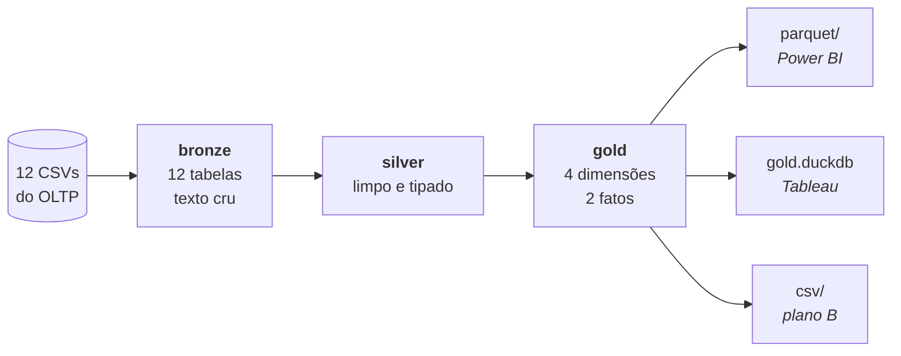

# CIC406 — Laboratório Lakehouse

Pipeline completo de um lakehouse local: dos CSVs crus do OLTP até uma camada **gold**
dimensional em [Apache Iceberg](https://iceberg.apache.org/), publicada para Power BI e Tableau.

Material da **Aula 07** da disciplina CIC406 — Business Intelligence, Big Data & Data Mining.
Dá continuidade ao caso de uso `DW_Rede_de_Hoteis`, modelado na Aula 04 e carregado em KNIME
na Aula 05.

**Pilha:** MinIO (ou disco local) · Apache Iceberg · PyIceberg · DuckDB · pandas / PyArrow

---

## O que este repositório produz



Camada gold ao final:

| Tabela | Linhas | Partição |
|---|---:|---|
| `gold.dim_geografia` | 40 | — |
| `gold.dim_estabelecimento` | 21 | — |
| `gold.dim_servico` | 12 | — |
| `gold.dim_tempo` | 543 | — |
| `gold.fato_servico` | **29.926** | `month(data)` |
| `gold.fato_hospedagem` | **35.774** | `month(data)` |

---

## Requisitos

Python 3.11+ e, opcionalmente, Docker.

```bash
python -m venv .venv
source .venv/bin/activate        # Linux / macOS
.venv\Scripts\activate           # Windows

python -m pip install -r requirements.txt
```

```text
pyiceberg[sql-sqlite,pyarrow,pyiceberg-core,s3fs]==0.12.0
pyarrow==26.0.1
pandas==3.0.5
duckdb==2.0.0
```

> [!IMPORTANTE]
> O extra **`pyiceberg-core`** é obrigatório a partir do PyIceberg 0.12. Sem ele a criação das
> tabelas funciona, mas o primeiro `append` numa tabela particionada falha com
> `NotInstalledError: pyiceberg_core needs to be installed` — no laboratório 2, longe da causa.

---

## Início rápido

```bash
cd scripts

python lab0_csv_vs_parquet.py ../dados ../saida_lab0   # CSV × Parquet
python lab1_catalogo.py ../dados                        # catálogo + bronze
python lab2_silver_gold.py                              # silver + gold
python lab3_inspecao.py                                 # inspeção + time travel
python lab4_serving.py ../gold_bi                       # publicação para BI
```

Rode sempre de dentro de `scripts/`: o [`conf.py`](scripts/conf.py) ancora o warehouse na pasta
acima, de modo que `wh/` e o catálogo ficam ao lado de `dados/`, e não dentro da pasta de código.

### Modo MinIO (opcional)

```bash
docker compose up -d     # console em http://localhost:9001
# crie o bucket  dw-hoteis  pelo console, e então acrescente --modo minio
# a cada laboratório, do 1 em diante:
python lab1_catalogo.py ../dados --modo minio
python lab2_silver_gold.py --modo minio
python lab3_inspecao.py --modo minio
python lab4_serving.py ../gold_bi --modo minio
```

O sinalizador `--modo` funciona igual em **PowerShell, cmd, bash e zsh**. Use-o em vez da
variável de ambiente: a sintaxe dela muda conforme o shell e é uma fonte garantida de atrito.

<details>
<summary>Se preferir a variável de ambiente <code>MODO</code></summary>

```bash
# bash / zsh
MODO=minio python lab1_catalogo.py ../dados
```

```powershell
# PowerShell -- precisa ser em duas instruções
$env:MODO = "minio"
python .\lab1_catalogo.py ..\dados

# para voltar ao modo local na mesma janela:
Remove-Item Env:\MODO
```

```bat
REM cmd.exe
set MODO=minio
python lab1_catalogo.py ..\dados
```

No PowerShell, `MODO=minio python ...` **não** funciona: ele interpreta `MODO=minio` como o nome
do comando a executar e devolve *"O termo 'MODO=minio' não é reconhecido como um nome de cmdlet"*.
A variável definida com `$env:` vale para o resto da janela, então lembre de limpá-la.

</details>

Sem Docker não é preciso fazer nada: o padrão grava em `wh/` no disco local e todo o resto
funciona idêntico. 

> [!NOTA]
> Cada modo tem o seu próprio catálogo — `hotel_catalog.db` no local, `hotel_catalog_minio.db` no
> MinIO. Os dois warehouses são lugares diferentes, e misturá-los num catálogo só deixaria tabelas
> apontando para onde você não está olhando. **Trocar de modo começa um lakehouse novo:** rode de
> novo a partir do laboratório 1.

---

## Estrutura

```text
.
├── dados/                      12 CSVs de origem (versionados)
├── scripts/
│   ├── conf.py                 catálogo e warehouse; único ponto que decide MinIO × disco
│   ├── lab0_csv_vs_parquet.py
│   ├── lab1_catalogo.py
│   ├── lab2_silver_gold.py
│   ├── lab3_inspecao.py
│   └── lab4_serving.py
├── docker-compose.yml          MinIO, opcional
├── requirements.txt
│
├── wh/                         warehouse        (gerado pelo lab 1)
├── hotel_catalog.db            catálogo SQLite  (gerado pelo lab 1)
│                               hotel_catalog_minio.db no modo MinIO
└── gold_bi/                    publicação       (gerada pelo lab 4)
```

Arquivo `.gitignore`:

```gitignore
.venv/
__pycache__/
wh/
gold_bi/
saida_lab0/
minio-data/
hotel_catalog*.db
```

---

## Laboratório 0 — O primeiro arquivo no bucket

[`scripts/lab0_csv_vs_parquet.py`](scripts/lab0_csv_vs_parquet.py) — grava o mesmo dado em CSV e
em Parquet, cronometra a leitura de **uma única coluna** nos dois e imprime os metadados que só o
Parquet tem. Ainda sem Iceberg.

| Medida | Valor |
|---|---|
| `ocupacao.csv` | 481.706 bytes |
| `ocupacao.parquet` (zstd) | 113.768 bytes |
| Redução | **4,2×** |
| Ler só `nr_ocupantes` do CSV | 3,9 ms |
| Ler só `nr_ocupantes` do Parquet | 0,8 ms |
| Ganho de leitura | **5,1×** |

A compressão varia com o dado — `ocupacao` 4,3×, `pedido` 3,3×, `cliente` 2,6×. Colunas de baixa
cardinalidade comprimem muito; RG e nome de pessoa quase não comprimem.

> [!DICA]
> Entre os metadados impressos aparece, para `nr_ocupantes`: **`min=0 max=7`**. O CHECK do modelo
> relacional diz 1 a 5. O Parquet denunciou um defeito de qualidade **sem ler uma única linha de
> dado**, só pela estatística do row group — e é exatamente esse metadado que, no laboratório 3,
> vai permitir pular arquivos inteiros numa consulta. A mesma mecânica, usada duas vezes.

---

## Laboratório 1/3 — Ambiente, catálogo e bronze

[`scripts/lab1_catalogo.py`](scripts/lab1_catalogo.py) — cria o catálogo, os três namespaces do
Medallion e aterrissa os 12 CSVs em bronze.

### As quatro camadas, nomeadas

| Camada | Neste repositório | Em produção |
|---|---|---|
| 1 — Object storage | MinIO, ou a pasta `wh/` | S3, ADLS, GCS |
| 2 — Formato de arquivo | Parquet, escrito pelo PyIceberg | o mesmo Parquet |
| 3 — Formato de tabela | Apache Iceberg (`.metadata.json` + `.avro`) | o mesmo Iceberg |
| 4 — Catálogo | SQLite | catálogo REST, Glue, Polaris, Unity |

São quatro peças separadas e substituíveis — trocar o SQLite por um catálogo REST não mexe em um
byte dos dados.

### Bronze preserva o defeito

A leitura usa `dtype=str` de propósito: `"  MOEMA "` continua com os espaços, `"128,00"` continua
com a vírgula, o `fim` vazio continua vazio. Bronze registra o que a origem entregou — é o que
permite reprocessar a silver amanhã sem pedir nada de volta.

**Conferência:** 12 tabelas, 50.638 linhas. `pedido` 35.613 · `ocupacao` 12.000 ·
`cliente` 2.514 · `quarto` 418 · `bairro` 40 · `estabelecimento` 21 · `servico` 12.

### Antes de seguir, abra o warehouse

Vá até `wh/bronze.db/pedido/`. Duas pastas:

- **`data/`** — o Parquet. É o dado.
- **`metadata/`** — os `.metadata.json`, o `snap-*.avro` e o manifest. É o que transforma aquela
  pasta em **tabela**.

Abra o `.metadata.json` num editor: são poucas dezenas de linhas com o schema, a spec de partição,
a lista de snapshots e um ponteiro para o snapshot corrente. Todo o resto do laboratório é
consequência desse arquivo existir.

---

## Laboratório 2/3 — Silver e Gold

[`scripts/lab2_silver_gold.py`](scripts/lab2_silver_gold.py) — limpeza e materialização do modelo
dimensional.

### Silver

| Tratamento | Conferência |
|---|---|
| Nome do bairro: `strip` + `title` | 40 bairros distintos |
| Valor do serviço: vírgula → ponto, float | 12 serviços tipados |
| Cliente: deduplicar por RG | 2.500 de 2.514 |
| Ocupação: `nr_ocupantes` 1..5, `fim` não vazio, `fim > inicio` | 11.547 de 12.000 |
| Pedido: remover órfãos | 35.436 de 35.613 |

> [!CUIDADO]
> O operador é `fim > inicio`, **nunca** `fim >= inicio`. As 120 ocupações de zero noites precisam
> sair. É regra de negócio, não detalhe de implementação — sobrevive à troca de ferramenta.

### A chave substituta sem SEQUENCE

```python
def chave64(*partes):
    """Chave substituta distribuível: hash de 64 bits da chave natural."""
    s = "|".join(str(p) for p in partes)
    h = hashlib.sha256(s.encode("utf-8")).digest()
    return int.from_bytes(h[:8], "big") >> 1   # 63 bits, sempre positivo

geo["chave_geografia"] = geo["id_bairro"].map(lambda b: chave64("bairro", b))
```

Determinística, sem estado, sem coordenação: cada máquina de um cluster calcula a mesma chave
sozinha, e um reprocessamento gera exatamente as mesmas chaves de ontem. É por isso que as chaves
de geografia são `LongType` e não `IntegerType` — 63 bits não cabem em 32.

Já `chave_estabelecimento` continua sendo o `id_estabelecimento` de 1 a 21, como `Integer`. Chave
natural compacta, estável e única não precisa de hash. Substituir por hash o que já é uma boa
chave é cerimônia, não engenharia.

### Os dois grãos, por escrito — antes de qualquer DDL

- **FATO_SERVICO** — uma linha por dia × bairro de origem do hóspede × estabelecimento × serviço ×
  número de ocupantes do quarto. Medidas: `qtd_servicos`, `valor_servicos`.
- **FATO_HOSPEDAGEM** — uma linha por dia × bairro de origem do hóspede × estabelecimento.
  Medidas: `qtd_hospedes` (pessoas-dia), `qtd_ocupacoes` (quartos-dia), `valor_diarias`.

O lakehouse barateou mudar o schema; **não** barateou mudar o grão. Acrescentar uma coluna é
alteração de metadado; mudar o grão é refazer a tabela e reescrever todo relatório construído
sobre ela.

### Schema e partição

```python
esq_fs = Schema(
    NestedField(1, "data",                   DateType(),        required=True),
    NestedField(2, "chave_geografia_origem", LongType(),        required=True),
    NestedField(3, "chave_geografia_estab",  LongType(),        required=True),
    NestedField(4, "chave_estabelecimento",  IntegerType(),     required=True),
    NestedField(5, "cd_servico",             IntegerType(),     required=True),
    NestedField(6, "nr_ocupantes",           IntegerType(),     required=True),
    NestedField(7, "qtd_servicos",           IntegerType(),     required=True),
    NestedField(8, "valor_servicos",         DecimalType(12,2), required=True),
)

# partição pelo TEMPO -- nunca pelo bairro
spec_fs = PartitionSpec(
    PartitionField(source_id=1, field_id=1000,
                   transform=MonthTransform(), name="mes_data"))
```

> [!CUIDADO]
> Particionar os fatos por `chave_geografia` parece natural — o desafio inteiro é no grão bairro.
> Mas 40 bairros × 543 dias produziria milhares de arquivos de poucos KB: o *small files problem*,
> em que o custo de abrir arquivo domina o de ler dado.
>
> **A regra: partição para o filtro grosso e previsível; clustering para o filtro fino e seletivo.**
> Toda consulta de BI filtra por período; nem toda filtra por bairro.

Note também o `DecimalType(12,2)` dos valores. Dinheiro em `float` acumula erro de arredondamento
ao somar dezenas de milhares de linhas, e a conferência não fecharia nos centavos.

### Conferência do laboratório 2

| Etapa | Esperado |
|---|---|
| Linhas após os joins da FATO_SERVICO | 34.199 |
| `gold.fato_servico` | **29.926** |
| soma de `qtd_servicos` | 34.199 |
| soma de `valor_servicos` | **R$ 3.827.668,80** |
| Soma de noites | 37.237 |
| Linhas após a explosão das diárias | 37.237 |
| `gold.fato_hospedagem` | **35.774** |
| soma de `qtd_hospedes` | 90.935 |
| soma de `qtd_ocupacoes` | 37.237 |
| soma de `valor_diarias` | **R$ 15.380.164,80** |

São os mesmos números do gabarito da Aula 05, obtidos por outro caminho e em outra ferramenta.
A modelagem dimensional não mudou ao trocar de plataforma — mudou o suporte físico.

---

## Laboratório 3/3 — Inspeção, time travel e evolução de partição

[`scripts/lab3_inspecao.py`](scripts/lab3_inspecao.py)

> [!NOTA]
> Este script **altera** a tabela: reprocessa um mês e evolui a partição. Para rodar de novo, rode
> antes o `lab2_silver_gold.py`. O script tem uma trava que recusa a segunda execução.

### O que o Iceberg realmente gravou

```python
fato.inspect.files().to_pandas()
fato.inspect.partitions().to_pandas()
fato.inspect.snapshots().to_pandas()
```

| Observação | Valor |
|---|---|
| Arquivos de dados no snapshot corrente | 18 |
| Linhas somadas nos arquivos | 29.926 |
| Tamanho total | 167.676 bytes |
| Menor / maior arquivo | 7.936 / 9.915 bytes |
| Partições (`MonthTransform`) | 18, de 1.195 a 1.855 linhas |

Arquivos de 8 KB são pequenos demais para produção — o alvo usual é 128 MB a 1 GB. Num volume de
verdade a mesma partição mensal daria arquivos no tamanho certo; aqui são minúsculos porque o
dataset é didático.

### Data skipping — o que substituiu o índice B-Tree

```python
filtro = And(GreaterThanOrEqual("data", "2026-04-01"),
             LessThan("data", "2026-05-01"))
scan = fato.scan(row_filter=filtro)
len(list(scan.plan_files()))   # arquivos que serão abertos
```

| Medida | Valor |
|---|---|
| Arquivos existentes na tabela | 18 |
| Arquivos que o scan abre | **1** |
| Linhas devolvidas | 1.702 |

Dezessete dos dezoito arquivos foram descartados sem serem abertos. E repare no que **não** foi
preciso fazer: o filtro é por DATA, a partição é por MÊS, e ninguém traduziu uma coisa na outra.
Isso é *hidden partitioning* — no DW clássico o usuário precisaria conhecer a coluna de partição,
ou o plano a ignoraria silenciosamente.

### A segunda carga: reprocessar abril

```python
abril = fato.scan(row_filter=filtro).to_arrow()
fato.overwrite(df=abril, overwrite_filter=filtro)
```

| | Antes | Depois |
|---|---:|---:|
| Arquivos no snapshot corrente | 18 | 18 |
| Arquivos `.parquet` no disco | 18 | **19** |
| Linhas na tabela | 29.926 | 29.926 |

> [!CUIDADO]
> **Há mais arquivos no disco do que na tabela.** O Parquet antigo de abril continua lá — é ele
> que permite voltar no tempo. O que diz quais arquivos valem é o snapshot, não o sistema de
> arquivos.
>
> Consequência prática: **quem apontar uma ferramenta de BI para a pasta `data/` soma abril duas
> vezes.** O número vem errado e plausível, que é o pior tipo de erro. É isso que justifica o
> laboratório 4.

### Time travel

```python
primeiro = fato.history()[0].snapshot_id
antigo = fato.scan(snapshot_id=primeiro).to_arrow()
```

A tabela no primeiro commit e a tabela agora têm as mesmas 29.926 linhas: o reprocessamento trocou
os arquivos, não os dados.

### Partition evolution — de mês para dia, sem reescrever nada

```python
with fato.update_spec() as us:
    us.remove_field("mes_data")
    us.add_field("data", DayTransform(), "dia_data")
```

| Antes | Depois |
|---|---|
| `[1000: mes_data: month(1)]` | `[1001: dia_data: day(1)]` |
| 18 arquivos | 18 arquivos — nenhum reescrito |
| 29.926 linhas | 29.926 linhas |

Alteração de metadado. Os arquivos antigos seguem particionados por mês, os próximos serão por
dia, e a mesma consulta lê os dois. Num DW clássico isso seria `ALTER TABLE` com reorganização
física, recriação de índices e janela de indisponibilidade.

---

## Laboratório 4/4 — A última milha: publicar para o BI

[`scripts/lab4_serving.py`](scripts/lab4_serving.py)

> [!IMPORTANTE]
> **Nem o Power BI Desktop nem o Tableau Desktop leem Apache Iceberg.** Não existe conector.
> No Power BI, suporte a Iceberg existe apenas no Microsoft Fabric, via atalho do OneLake — não no
> Desktop. No Tableau, Parquet só entra pelo conector Amazon S3, que exige credenciais AWS reais e
> não aponta para um MinIO local.
>
> Isso não é falha do laboratório: é a arquitetura real. A camada gold de um lakehouse é um
> formato de engenharia; o consumo por ferramenta de mesa pede um passo de publicação. Esse passo
> tem nome — *serving layer*.

### Ler a gold pelo caminho certo

```python
t = cat.load_table("gold.fato_servico")
arrow = t.scan().to_arrow()      # só os arquivos do snapshot corrente
```

O `.scan()` consulta o snapshot e devolve apenas os arquivos válidos. É por isso que a publicação
passa pelo PyIceberg e nunca por um `glob` na pasta `data/`.

### Três formatos

| Formato | Para quem | Tamanho total |
|---|---|---:|
| `gold_bi/parquet/` — 6 arquivos | Power BI Desktop, nativo | 257.236 bytes |
| `gold_bi/gold.duckdb` | Tableau (JDBC), Power BI (ODBC) | 2.371.584 bytes |
| `gold_bi/csv/` — 6 arquivos | Plano B universal | 4.368.669 bytes |

Os três contêm exatamente os mesmos dados — as somas foram conferidas nos três. A comparação
fecha o arco do laboratório 0: **257 KB em Parquet contra 4,3 MB em CSV**, agora sobre o dado
modelado em vez do dado cru.

### Power BI Desktop

1. **Obter Dados → Parquet →** informe o caminho completo do arquivo (o campo se chama URL, mas
   aceita caminho local) → Anônimo → Carregar.
2. Repita para as seis tabelas e monte o modelo estrela em **Modelo**.
3. As duas chaves de geografia exigem **duas cópias da `dim_geografia`** (ou uma relação ativa e
   uma inativa com `USERELATIONSHIP`).
4. Marque a `dim_tempo` como tabela de data (**Ferramentas de Tabela → Marcar como tabela de
   data → coluna `data`**).

Limitações: o conector Parquet é **somente Importação** (sem DirectQuery), e arquivos muito
grandes falham com `Parquet.Document cannot be used with streamed binary values`.

### Tableau Desktop

1. Baixe o `duckdb_jdbc` `.jar` da **mesma versão** do DuckDB que gerou o arquivo (aqui, 2.0.0) e
   copie para `C:\Program Files\Tableau\Drivers` (Windows) ou `~/Library/Tableau/Drivers/` (macOS).
   Reinicie o Tableau.
2. **Conectar → A um servidor → Mais… → Outros bancos de dados (JDBC).**
   URL `jdbc:duckdb:/caminho/completo/gold.duckdb`, dialeto **PostgreSQL**.
3. Limitação documentada desse caminho: **`median` e `percentile` não ficam disponíveis.**
4. Se a instalação do driver falhar, use `gold_bi/csv/` — o Tableau lê CSV nativamente e o modelo
   estrela se monta igual.

> [!CUIDADO]
> O DuckDB aceita **um único processo de escrita por arquivo**. Feche a sessão Python antes de
> abrir o `gold.duckdb` no Tableau ou no Power BI, ou abra em modo somente leitura.

### Teste de aceite

O script roda quatro consultas sobre o que acabou de publicar:

```sql
-- faturamento de serviços por região de ORIGEM do hóspede
SELECT g.nm_regiao, SUM(f.valor_servicos) AS total
  FROM fato_servico f
  JOIN dim_geografia g ON g.chave_geografia = f.chave_geografia_origem
 GROUP BY 1 ORDER BY 2 DESC;
```

| Região de origem | Faturamento em serviços |
|---|---:|
| Sudeste | R$ 2.244.263,00 |
| Sul | R$ 1.019.040,50 |
| Nordeste | R$ 564.365,30 |
| **Total** | **R$ 3.827.668,80** |

As outras três: gasto médio por número de ocupantes do quarto (a análise que depende da dimensão
degenerada), diárias e pessoas-dia por segmento da unidade, e um **drill across** somando receita
de diárias e de serviços por mês. Todas respondem em menos de 5 ms.

O drill across é a prova de que a constelação está correta: se as dimensões não fossem
conformadas — se cada fato tivesse a sua própria cópia de geografia, com chaves diferentes — a
consulta que soma os dois fatos por mês simplesmente não poderia ser escrita.

---

## Solução de problemas

| Sintoma | Causa |
|---|---|
| `NotInstalledError: pyiceberg_core needs to be installed` | Falta o extra `pyiceberg-core`. Reinstale com `pip install -r requirements.txt` |
| `Esta tabela já passou pelo laboratório 3` | Trava de reexecução. Rode `lab2_silver_gold.py` antes |
| `O termo 'MODO=minio' não é reconhecido...` | Sintaxe de bash no PowerShell. Use `--modo minio` |
| `Modo desconhecido: '...'` | Erro de digitação. Só `local` e `minio` são aceitos |
| Tabelas somem ao trocar de modo | Cada modo tem catálogo próprio. Rode do laboratório 1 |
| `wh/` e `hotel_catalog.db` dentro de `scripts/` | O script foi executado de fora de `scripts/` |
| Números maiores que o esperado no BI | A ferramenta foi apontada para `data/` em vez da publicação em `gold_bi/` |
| Erro de `lock` ao abrir o `.duckdb` | Sessão Python ainda aberta sobre o arquivo |
| Somas que não fecham nos centavos | Valor monetário como `float` em vez de `DecimalType(12,2)` |
| `NoSuchTableError: bronze.<tabela>` | O lab 1 não concluiu. Rode-o de novo sem interromper |

---

## Versões validadas

| Pacote | Versão |
|---|---|
| Python | 3.13 |
| pyiceberg | 0.12.0 |
| pyarrow | 26.0.1 |
| pandas | 3.0.5 |
| duckdb | 2.0.0 |

Uma observação sobre o DuckDB: a extensão `iceberg` **não** é usada aqui. O `ATTACH` de catálogo
exige um catálogo REST, e um `SqlCatalog` em SQLite não é um; a leitura direta precisaria do
caminho explícito do `.metadata.json`, porque o PyIceberg não mantém `version-hint.text`. O
serving usa o PyIceberg como leitor, que é também o escritor — divisão de trabalho correta e sem
dependência de download de extensão em sala.

---

## Sobre os dados

12.000 ocupações, 35.613 pedidos, 2.514 clientes, 21 unidades em 40 bairros de 6 cidades, de
janeiro/2025 a junho/2026. Os CSVs trazem **cinco defeitos de qualidade propositais**: nomes de
bairro com espaço e caixa inconsistente, vírgula decimal no valor do serviço, clientes duplicados
por RG, ocupações violando o CHECK de 1 a 5 ocupantes com datas inválidas, e pedidos órfãos.

Os números de conferência só fecham depois de tratá-los — é o mecanismo que prova que a limpeza
foi feita.

---

## Créditos

Prof. Dr. Marco Aurélio Mazzei
CIC406 — Business Intelligence, Big Data & Data Mining
